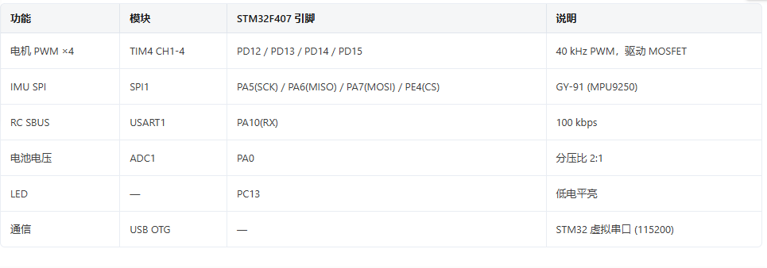

<tr>                                                                    
<td> 
</td>

#在windos下powershell编译
# 1.安装platformio平台
python -m pip install --user platformio

 重定向缓存 (可选, 避免 C:\Users\admin\.platformio 权限问题)
$env:PLATFORMIO_CORE_DIR = "c:\Users\admin\Desktop\flix-master\flix-stm32\.pio_core"

# 2. 首次构建 (会自动下载 ststm32 + arm-none-eabi-gcc + Arduino + 3 个第三方库)
python -m platformio run

# 3. 烧录 (插 ST-Link V2 或板载 ST-Link)
python -m platformio run -t upload

# 4. 串口调试 (115200 baud)
python -m platformio device monitor -b 115200